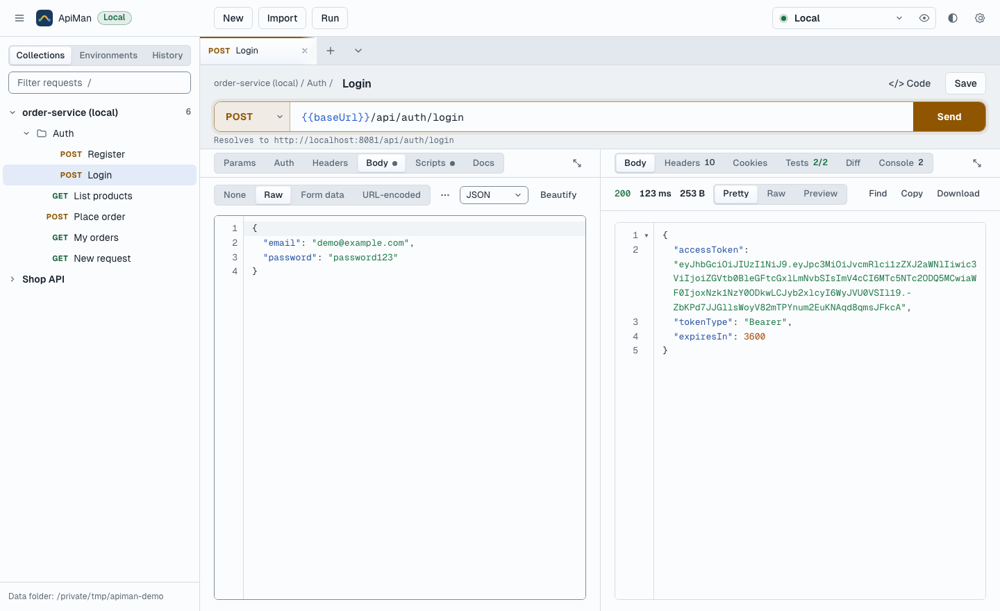
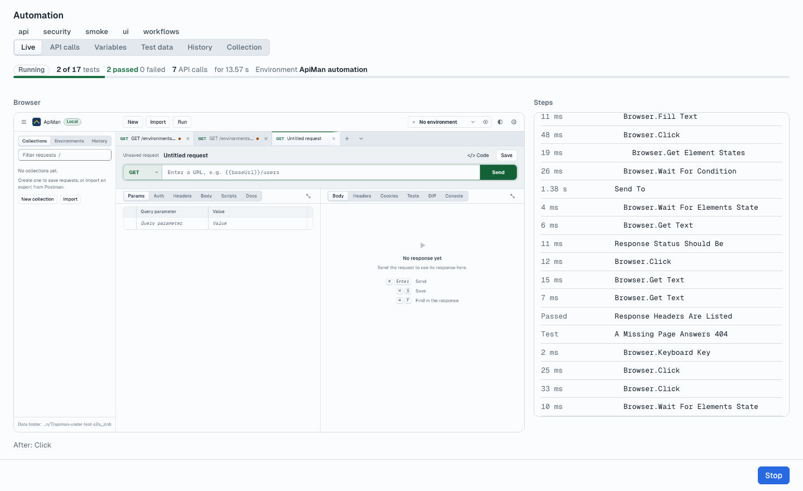
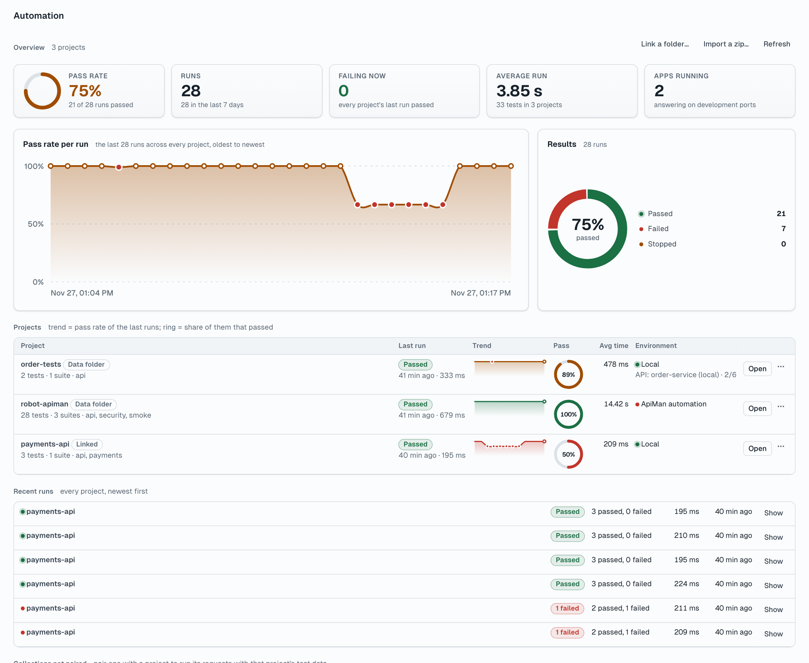
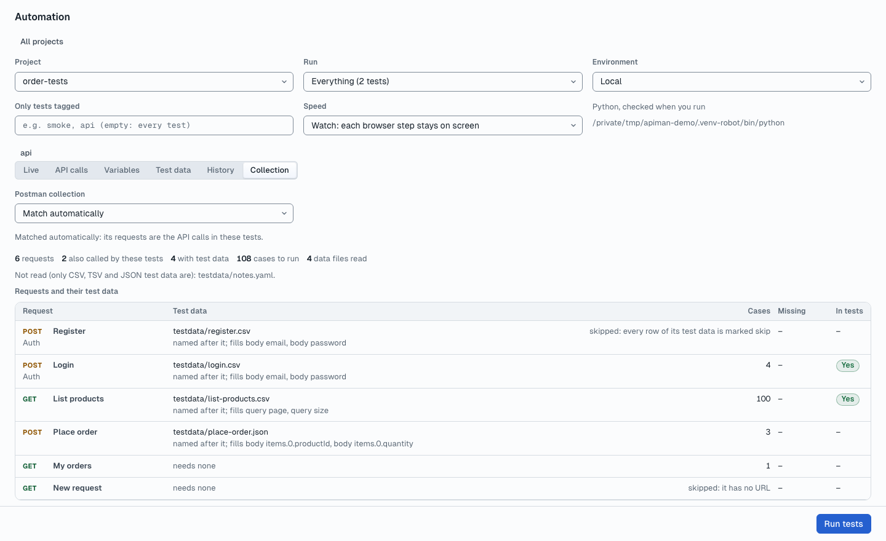
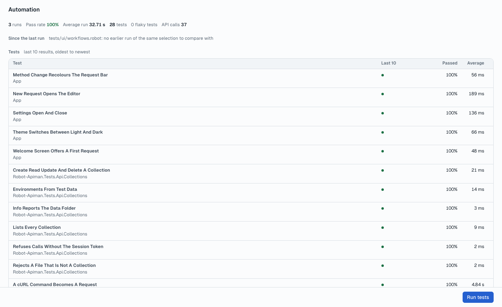
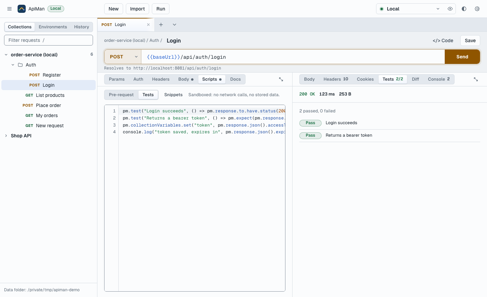
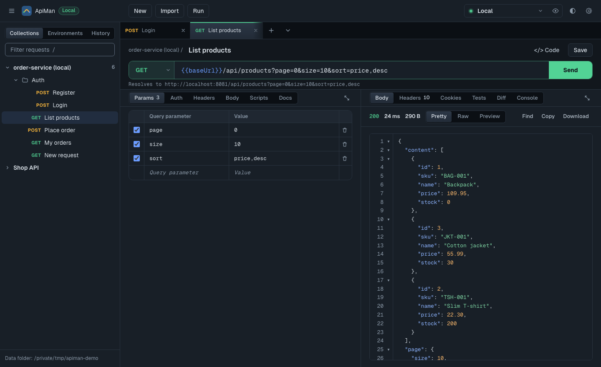

# ApiMan

**A private, local API client, with Robot Framework automation built in.** Send requests, script them and test them
like in Postman, then run your Robot Framework UI and API suites in the same app and watch the browser live. There's no
account and no cloud: your collections are plain Postman files in a folder you choose, and ApiMan updates itself when
that folder changes.

[**Download for macOS or Windows**](../../releases/latest) · [Run from source](#run-from-source) · [What makes it different](#what-makes-apiman-different) · [Screenshots](#a-quick-tour)



## What makes ApiMan different

- **Robot Framework automation, built in.** Point ApiMan at any Robot project (a folder, a zip, or one in your data
  folder). It finds the suites, tests, tags, test data and the environment keys they need, runs them with the
  project's own Python, and shows a **UI test's browser live inside the app**, step by step. Every HTTP call is
  listed, failures keep a screenshot, and History tracks pass rate, flaky tests, what changed since the last run, and a
  frame-by-frame **replay** of any UI test.
- **Your collection and your test data become one suite.** ApiMan pairs a Postman collection with the Robot project
  that calls the same APIs, by method and path. It then runs every request with that project's CSV or JSON test data
  (`expectedStatus`, skip rows, negative cases), using the same environment as the Robot tests. The results land in the
  same History.
- **Plain Postman files in your own folder.** Collections are Postman v2.1 `.json` files and environments are Postman
  environment files. They live in any tree of folders, are found by their content, and are ready for git. There's no
  import or export step, and nothing to convert.
- **The folder is the source of truth.** A `git pull`, an editor or a synced team folder: ApiMan notices the change
  within seconds and shows it. Tabs with unsaved edits are left alone.
- **No account, no cloud, no telemetry.** Requests go out from your computer, so they work over a VPN, reach internal
  hosts, and have no CORS limits. The local server listens on `127.0.0.1` only, behind a per-launch token and a Host
  check.
- **Imported scripts can't phone home.** Collection scripts run in a sandboxed worker with no network access. If a
  script tries to change where a request goes, ApiMan asks you first, and credentials never follow a redirect to
  another site.
- **Small, with nothing to install.** The desktop app is a native window of about 25 MB, not a bundled browser. From
  source it's one Python file using only the standard library, plus a static page: `python3 server.py` and you're in.
- **Details that save time.** Diff a response against the previous one, a pinned one, or **another environment**.
  Right-click a JSON value to generate a test for it. See exactly where `{{variables}}` resolve before you send.
  Generated code (cURL, HTTPie, PowerShell, fetch, Python, Java, Go) matches what is actually sent.

### Compared with other API clients

| | **ApiMan** | Postman | Insomnia | Bruno | Hoppscotch |
|---|---|---|---|---|---|
| Robot Framework UI and API runs, with a live browser view | **Yes** | No | No | No | No |
| A collection run with your automation project's test data, in one suite | **Yes** | No | No | No | No |
| Storage is plain Postman v2.1 files in your folder (git-friendly) | **Yes** | Cloud workspace; files by export | Own format | Own `.bru` files | Own format |
| Use without an account | **Yes** | Needed to save collections | Optional | Yes | Optional |
| Updates itself when files change on disk | **Yes** | No | No | Yes | No |
| Desktop app technology | **Native web view, ~25 MB** | Electron | Electron | Electron | Tauri / web |
| Runs from source with no dependencies | **Yes** (Python standard library) | No | No | No | No |
| Command-line runner with JUnit output | Yes (`server.py run`) | Yes (Newman) | Yes (Inso) | Yes | Yes |

<sub>Compared from each product's public documentation in November 2026. Plans and features change, so check theirs
for the current state. ApiMan reads and writes Postman files, so you can move back and forth.</sub>

## A quick tour

**Automation: a UI test running, with the browser inside ApiMan.** Each step updates the view, and the steps and API
calls are listed beside it.



**The Automation dashboard.** Your test health at a glance: pass rate, runs, what's failing now, average run time and
the apps running on this computer; the pass rate of every run over time (failures in red) and runs by result; every
project with its last run, a trend sparkline, its pass rate and its environment's health; and the latest runs.



**A collection as a test suite.** The order-service collection, paired with its Robot project. Each request finds its
test data (`login.csv`, `list-products.csv`, ...) and which fields that data fills. 108 cases run from one click.



**History.** Pass rate, flaky tests, what changed since the last comparable run, and every test's recent results.



**Tests in scripts, like Postman's.** `pm.test`, `pm.expect`, variables and the Console all work.



**Light, dark, or your own accent colour.**



## Run from source

```bash
git clone https://github.com/MrArun005/ApiMan.git && cd ApiMan
python3 server.py                     # opens http://127.0.0.1:5577
python3 server.py --data ~/my-apis    # keep collections + environments somewhere else
python3 server.py --ca-file ~/company-root-ca.pem   # trust internal HTTPS certificates
python3 server.py run api.json -e staging.json --junit report.xml   # run a collection headlessly (CI)
python3 test_server.py                # server self-check
node tools/layout-check.mjs           # layout check: 634 combinations of width, sidebar, layout, text, density, divider and panel, Automation included (needs Playwright and ApiMan running; no other server)
node tools/ui-lint.mjs                # the design system (DESIGN.md): every class, control and colour must come from it
```

You only need Python 3. There's nothing to install.

## Your data

- **Local mode** (`python3 server.py`): requests go out from your own computer, so they work over your VPN, reach internal hosts, and have no CORS limits. Everything is saved in the data folder (`collections/`, or `--data`).
- **Website mode** (GitHub Pages): open the page and send requests straight from the browser. The API must allow cross-site requests (CORS). In Chrome and Edge, ApiMan asks on start which folder on your computer to keep your data in (and offers to copy in what the browser already holds); you can also keep it in the browser for now. Firefox and Safari can't open folders, so data stays in the browser there.

**Where your data lives.** In the data folder, collections are `*.json`, environments are `environments/*.json`, and your workspace (settings, open tabs, history, layout) is `.apiman/state.json`. The browser only keeps a cache of it, so clearing browser storage loses nothing. OAuth tokens and kept responses are never written to the folder: they last only as long as the browser tab.

**Folders become categories.** Organise the data folder in any tree of folders (`payments/v2/Refunds.json`, `team/staging.postman_environment.json`, …): ApiMan finds every collection and environment in it, up to 8 levels deep, by what the file contains rather than its name or place, so Postman exports work as they are. Other JSON files are left alone, and so are hidden folders (`.git`, `.apiman`) and `node_modules`. The sidebar shows each folder as a category you can open and close, collections and environments save back to their own file, and a category's menu creates or imports straight into that folder. The environment picker shows a folder in front of the name (`payments / Staging`). The same works in website mode with a folder; data kept only in the browser has no folders.

## Desktop app

Download **ApiMan-macOS.zip** or **ApiMan-Windows.zip** from the latest [release](../../releases), or from the artifacts of the newest *Desktop app* run under Actions. Unzip it and open ApiMan. It needs no Python and no browser: it is a standalone app with its own native window (like Postman) and quits when you close that window. Your data lives in `~/ApiMan` until you pick your own folder: **Settings → Requests → Data folder → Change…** takes any folder (one parent folder with your collections, environments and Robot projects, in subfolders too), and the app remembers it. Automation opens as a second window.

**The data folder updates ApiMan by itself.** Add, edit or delete files in it (a `git pull`, an editor, a synced team folder, a new Robot project) and within a few seconds ApiMan shows the change: collections, environments, request tabs you haven't edited, and the Automation dashboard. Tabs with unsaved edits are kept as they are.

The builds aren't signed yet, so the first time, macOS needs right-click → **Open**, and Windows needs **More info → Run anyway**. To run Robot projects, Robot Framework must be installed on that computer: use the project's own `.venv`, a `.venv-robot` in your data folder, or `python3`.

To build it yourself: `python3 -m pip install pyinstaller pillow pywebview && python3 tools/build_desktop.py`, which puts the app in `dist/`. A version tag (`git tag v1.0.0 && git push --tags`) publishes both builds as a release.

## Use ApiMan from Claude and other AI tools (MCP)

`mcp_server.py` makes ApiMan an MCP server, so an AI assistant such as Claude Code or Claude Desktop can use your
collections, environments and Robot Framework projects. It reads your data folder directly, so ApiMan doesn't need
to be running.

```bash
claude mcp add apiman -- python3 /path/to/ApiMan/mcp_server.py --data ~/ApiMan-data
```

For Claude Desktop, add it under `mcpServers` in its settings file:
`{"apiman": {"command": "python3", "args": ["/path/to/ApiMan/mcp_server.py", "--data", "/Users/you/ApiMan-data"]}}`.

| Tool | What it does |
|---|---|
| `list_collections`, `list_requests` | your collections and their saved requests (method, URL, folder) |
| `list_environments` | environments and their variable **names** (values are never shown to the assistant) |
| `send_request` | send a saved request with an environment: variables, path variables and auth (bearer, basic, API key) applied, sent from your computer |
| `send_http` | send a one-off request |
| `list_robot_projects`, `run_robot` | list Robot projects, then run one, a suite, a test or tags, and get the result with each failure's message |
| `list_runs`, `get_run` | recent runs and their results (runs started from MCP also show in Automation History) |

Responses come back with cookies, credential headers, token and password fields, and the values of Secret variables and auth credentials hidden (`•••`). Extra `variables` from the assistant may fill in a request but never change its scheme, host or port, so your saved auth can't be sent elsewhere. Pre-request and test scripts don't run from MCP,
because they run in the app's sandbox, and requests that use OAuth 2.0 need a sign-in in the app.

## Run collections in CI

`python3 server.py run` runs a collection from the command line, the job Postman needs Newman (npm) for. It uses the Chrome, Chromium or Edge already on the machine in headless mode, so scripts run in the same sandbox as in the app, and there's still nothing to install.

```bash
python3 server.py run orders.json -e staging.json            # live results; exit code 1 if a test fails or a request can't be sent
python3 server.py run orders.json -e staging.json --var token=$API_TOKEN --junit report.xml --json report.json
python3 server.py run orders.json --folder Smoke -n 3 --delay 200 --bail
python3 server.py run orders.json -e staging.json -d customers.csv --html report.html   # once per data row, with an HTML report
```

- `--junit FILE` writes a JUnit XML report that GitHub Actions, GitLab and Jenkins show as test results; `--json FILE` writes the same results as JSON.
- `--html FILE` writes one self-contained HTML report (summary, then each request with its tests). It leaves out request and response headers and bodies unless you add `--report-bodies`, and even then masks Authorization, Cookie and token, secret, password and API-key headers.
- `-d`/`--iteration-data FILE` runs the collection once per row: a CSV with a header row (UTF-8, quoted values may hold commas and line breaks), or a JSON array of flat objects. Each column is a `{{column}}` variable for that iteration, and scripts read it with `pm.iterationData.get('column')`. `-n` caps the number of rows run. Up to 100 000 rows and 20 MB. The console and every report say which iteration and data row each result came from.
- `--var KEY=VALUE` sets environment variables, handy for secrets from the CI's environment. `--browser` (or `APIMAN_BROWSER`) points at a browser if it isn't found automatically.

Requests that need an OAuth sign-in window can't run headless; use client credentials there. For GitHub Actions, copy [`docs/ci/github-actions.yml`](docs/ci/github-actions.yml): it runs a collection with a secret token and a data file and keeps the JUnit and HTML reports as artifacts, even when tests fail.

## Automation: run Robot Framework projects, UI and API, live

Click **Run → Automation** (local mode). It opens on a **dashboard**: a card per project with its tests and tags, last result, a trend of recent runs, the environment it uses and whether that environment's app is answering, and **Open** / **Run**. Totals across projects sit on top.

Automation opens in **its own window** (`http://127.0.0.1:5577/#automation`, which you can bookmark): Run → Automation opens it, or brings it to the front if it's already open, without reloading it. Keep the dashboard on one screen and the API client on another; they share the same data, environments and runs, and nothing is copied. The Automation window never saves the API client's tabs, so it can't overwrite the main window's. If the browser blocks pop-ups, Automation opens over the API client instead.

Bring projects in any of three ways:

- **Link a folder**: any folder on this computer with `.robot` files. It's remembered and run where it is; nothing is copied.
- **Import a zip**: unpacked safely into your data folder (a zip up to 36 MB; no paths outside it, no links, at most 300 MB / 10,000 files unpacked).
- **Put it in your data folder** (copy it, or clone the repo there).

Below the cards, **Apps running on this computer** lists what answers on the usual development ports (3000, 4200, 5173, 8000, 8080, 8081…), with one click to create an environment whose `BASE_URL` is that app, and **Environments** shows, for each environment, whether the apps its URLs point at are answering right now (only each app's address is asked, never a path from your values, and secret values are skipped). Each project remembers its own environment (first time: the one with most of the keys it needs).

**API suites: a Postman collection and a Robot project for the same APIs are one suite.** When a collection's requests are the API calls a Robot project makes (same method and path; `{{id}}`, `${ID}`, `:id` and `42` all count as a value), ApiMan pairs them, with no setup. You can change the pairing in the project's **Collection** tab, or from **Collections not paired** on the dashboard.

- **One environment:** the one that points at the collection's host is chosen for both. Robot reads `${BASE_URL}` from `baseUrl` (it ignores case and `_`), and if an environment spells a key differently from what the collection needs, ApiMan offers to rename it: one key, never a duplicate. "Create environment" reuses one that already points at the same app.
- **Test data comes from the Robot project:** its CSV, TSV and JSON files. For each request, in order:
  1. A file (or JSON key) named after it or its folder (`login.csv` for *Login*).
  2. Rows of a `request` column naming it.
  3. The data whose columns fill the request's `{{variables}}`.
  
  A column also fills the request's own fields of the same name: JSON body (nested: `items[0].quantity`), query, path variables, form fields. Types are kept, and nothing is invented. Each row is one case. Special columns:
  - `expectedStatus` makes the row a status check, so negative rows pass on their 4xx and never change variables later requests use;
  - `case` labels the row;
  - `skip` skips it.
  
  Test data can never change which server a request goes to. At most 100 rows per request and 5,000 cases per run. YAML and Excel files are listed as not read.
- **A collection run is a result of the suite:** **Run API** (on the card) or **Run collection with test data** (Collection tab) runs in ApiMan with the same live view, API calls, failures and History as the Robot runs, marked API. A page closed mid-run is recorded as stopped; a request cut off by Stop isn't counted.

**History** shows what changed since the last run of the same selection (new failures, fixed, slower). It also shows every test with its last 10 results, a pass rate and badges (New failure, Fixed, Flaky, Failing), and the screen of each failure in the last run, with **Replay** to step through that test's screens. Tag chips under *Only tests tagged* filter a run in one click.

ApiMan finds everything in a project on its own:

- **Suites, tests and tags** from every `.robot` file: run everything, one suite, one test, or only tests with a tag.
- **Environment keys** from the variables the project uses but never defines (`${BASE_URL}`, `${PASSWORD}`…). Pick an ApiMan environment and the Variables tab shows what's filled in and what's missing, with one click to add the missing keys. The project's own variable files (`env/qa.yaml`, `config/prod.py`) are offered too.
- **Test data**: JSON, CSV, YAML and XML files, to read and edit, plus a JSON object of values for one run (each key becomes a `${variable}`, over the environment's value).
- **The project's Python**: its own `.venv`/`venv` first, then ApiMan's `.venv-robot`, then the system's (or `APIMAN_ROBOT_PYTHON`). If Robot Framework is missing, it says exactly what to install.

Click **Run** and watch it, inside ApiMan:

- **Live browser**: UI tests (Browser library) run headless and the screen appears in ApiMan after every step that changes the page, large, beside the steps.
- **Steps**: every test and keyword with its time, failures in red. Robot's console output also goes to the terminal running `server.py`.
- **API calls**: every HTTP request the tests make through `requests` (RequestsLibrary or your own Python keywords), with headers, request and response bodies, status, time and errors. Credentials in headers are hidden.
- **Failures**: each failed test with its error and the screen at the moment it failed.
- **History**: the last 200 runs are kept (`<data>/.apiman/runs/`) with Robot's report and log (shown in ApiMan): pass-rate and duration charts, what changed since the previous run (new failures, fixes, tests that got slower), every test's recent results with flaky and failing ones marked, the last run's failures with screenshots, and a step-by-step replay.

A project is a folder with `.robot` files of its own, or one that looks like a project root (`.git`, `requirements.txt`, `tests/`, `resources/`…) with `.robot` files below it, up to 4 levels down. `examples/robot-apiman` is a sample project: UI and API tests for ApiMan itself, which start a throwaway ApiMan to test (set `BASE_URL` and `APIMAN_SERVER` in an environment).

To get Robot Framework for the sample: `python3 -m venv .venv-robot && .venv-robot/bin/pip install robotframework robotframework-browser robotframework-requests && .venv-robot/bin/rfbrowser init chromium`.

## Features

| | |
|---|---|
| **Requests** | All methods, a Params table kept in sync with the URL, Postman path variables (`/users/:id`), headers, and multiple tabs with unsaved work restored after a reload. URLs with spaces or non-ASCII characters are percent-encoded when sent (a non-ASCII host becomes IDNA), and `user:password@` in a URL is sent as Basic auth. Compressed responses (gzip, deflate, and Brotli when the `brotli` package is installed) are decoded. Redirects follow browser rules: 307 and 308 keep the method and body, 301, 302 and 303 become GET. The limit is in Settings, and a response that hits it says so. **Cookies** that responses set are kept per data folder and sent to the same site later, including within a redirect chain. Manage them from Settings or the response's Cookies tab, turn them off in Settings, and read them in scripts with `pm.cookies`. A GET body is sent, as Postman does; a HEAD body never is. |
| **Editors** | Code editors with line numbers, syntax colours, bracket matching, search (<kbd>Cmd/Ctrl+F</kbd>) and collapsible JSON/XML, for bodies, scripts, responses and generated code (CodeMirror, bundled) |
| **Bodies** | JSON / text / XML / HTML raw, form data with file uploads, URL-encoded, binary file, GraphQL |
| **Auth** | Bearer token, Basic, API key (header or query), **OAuth 2.0** (authorization code with PKCE, client credentials, password), inherited from folder or collection, or none. OAuth tokens are fetched when you send and refreshed automatically when they expire, no "Get token" click needed (authorization code opens a sign-in window once). Register `http://127.0.0.1:5577/oauth-callback.html` (or your site's `oauth-callback.html`) as the redirect URI |
| **Variables** | Environments, collection variables, globals and dynamic values (`{{$guid}}`, `{{$timestamp}}`, …), with a live "Resolves to" preview under the URL |
| **WebSocket** | Type a `ws://` or `wss://` URL and Send becomes Connect: a live, filterable message log (JSON pretty-printed, millisecond timestamps) with a composer that resolves `{{variables}}`. Uses the browser's own WebSocket, in both modes. Browsers can't send custom headers on a WebSocket, so ApiMan says which ones it couldn't send; `Sec-WebSocket-Protocol` is sent as the subprotocol |
| **Scripts** | Pre-request and test scripts with Postman's `pm.*` commands (`pm.test`, `pm.expect`, `pm.response`, `pm.environment`, `pm.sendRequest` with a callback or `await`, …), plus snippets. Test scripts see the request as it was sent, with variables resolved |
| **Click-to-test** | Right-click any value in a JSON response (or put the cursor on it and press the menu key or <kbd>Shift+F10</kbd>) to add a test without writing code: *equals this value*, *exists*, *is a string/number/list…*, *is not empty*, or *save it to a variable* for the next request (e.g. a login token). ApiMan writes the `pm.test` into the request's Tests script, where you can edit it |
| **Runner** | Run a collection or folder, with iterations, delay, stop on failure, and live pass/fail results. Values scripts set carry to the next request (`/orders/{{orderId}}` chaining works), except ones that could change which server a request goes to. **Data files**: choose a CSV (header row, one row per iteration) or a JSON list of flat objects, and each row's columns become `{{variables}}` (above the environment, below `pm.variables`) and `pm.iterationData`. Scripts can steer the run with `pm.execution.setNextRequest(name)` (`null` ends the iteration; at most 10 000 extra requests per run) and `pm.execution.skipRequest()`. After a run, **Export report** saves an HTML report (one file, no scripts), JSON or JUnit; headers and bodies only if you tick them, with Authorization, cookies, tokens, secrets, passwords and API keys masked. Also from the command line (see above) |
| **Responses** | Pretty (highlighted JSON) / raw / preview views, headers, cookies, test results, script console, copy, save to file |
| **Diff** | Compare a response with the previous one, one you pinned, or **the same request sent with another environment** (staging vs prod) in one click, without switching environments. JSON is compared field by field (key order and formatting don't count; list items with an `id` are matched by it), with a line view too. Ignore noisy fields by name or path (`updatedAt, data.items[*].etag`); headers that change on every response (Date, request ids…) are skipped |
| **Import / export** | Postman collections v2.1, environments and globals, cURL commands (paste into the URL bar or use Import), export as JSON |
| **OpenAPI** | Import OpenAPI 3.x or Swagger 2.0 specs, JSON or YAML (drop, choose or paste). Each tag becomes a folder, and `{{baseUrl}}` comes from the spec's server. Requests get example bodies built from the schemas, path, query and header parameters (optional ones turned off), and auth (bearer, basic or API key, with OAuth 2 as a bearer token). Every request also gets **contract tests**: the status must be one the spec documents, and a 2xx body must have the schema's required fields. Run the collection in the Runner to check a live API against its spec |
| **Code** | cURL, HTTPie, PowerShell, JavaScript fetch, Python requests, Java HttpClient, Go net/http (secrets hidden by default) |
| **Your layout** | Drag the sidebar edge and the request/response divider (live size readout, arrow keys, double-click resets); maximise either pane; sidebar left, right or hidden (<kbd>Cmd/Ctrl+B</kbd>); side-by-side or stacked |
| **Appearance** | Light / dark / system theme, accent colour (presets or any colour), interface and code fonts, interface text size, code size, density, code line height, tab width, line wrapping: every size as a slider and an exact number |
| **Comfort** | Filter, history, keyboard shortcuts (<kbd>Ctrl/Cmd+Enter</kbd> send, <kbd>Ctrl/Cmd+S</kbd> save, <kbd>/</kbd> filter), full keyboard navigation in the sidebar tree |

## Safety

- **Scripts are sandboxed.** Imported collections can contain scripts you didn't write. In ApiMan, every script runs in a Web Worker inside a sandboxed iframe whose Content-Security-Policy is `default-src 'none'`. A script can't make network requests of its own, can't read ApiMan's storage or the page, and is stopped after 5 seconds, so an endless loop can't freeze the app.
- **`pm.sendRequest` goes through ApiMan, under its rules.** The script only describes the request; ApiMan checks it and sends it. Without asking, a script may only call the servers its own collection uses (the request being run, or any saved request in the collection, resolved with your saved variables). For any other server, Send asks you once per server per collection until you close ApiMan, showing the full URL; the runner and `server.py run` refuse it (unless you allowed that server with Send earlier in the session) and say so in the Console. ApiMan adds nothing to the request: only the headers the script set are sent, never your auth or cookies, and redirects aren't followed. A script can make at most 10 requests per run, each gets 30 seconds, and a script that waits for them is still stopped after 60 seconds in total. Every call is listed in the Console, with a warning when it goes over plain `http://`.
- **Scripts can't quietly send your request elsewhere.** If a pre-request script changes which server a request goes to, ApiMan asks before sending it there with your auth. In the runner, where there's no one to ask, it blocks the request, and a value a script sets is only carried to the next request if it can't change any request's server: ApiMan puts a hostile test value in its place in every saved URL, under every environment, and checks that no destination moves (path and query values pass, host, port and scheme values don't). If a script changes or deletes variables in a way that would send any saved request to a different server, you're asked before the change is saved (the check resolves every request's URL, so variable names don't matter). Every variable a script changes is listed in the Console.
- **Automation runs your project's code, only when you click Run.** A Robot Framework project is code (its Python libraries and its own `.venv` run with your permissions), so ApiMan runs one only when you start it from the Automation screen, never on its own (listing a project reads its files and runs nothing), and only projects in your data folder or folders you linked yourself. Zips are unpacked into the data folder only after every path is checked. Values from environments reach Robot in a temporary file only you can read, deleted when the run ends, never on the command line. Run logs stay in `<data>/.apiman/` (owner-only, ignored by git), and Robot's report and log are shown in a sandbox that can't reach ApiMan's API.
- **Imported methods are validated.** HTTP methods from imported files are checked, and generated shell code quotes every value.
- **Credentials never follow a redirect to another site.** When a redirect changes the scheme, host or port, only harmless headers (Accept, Accept-Language, Accept-Encoding, User-Agent, Content-Type) are kept, and the response tells you which ones were removed. HTTPS is never downgraded to HTTP.
- **Only ApiMan can use the local server.** It listens on `127.0.0.1` only, and it rejects requests from other websites (Origin check) and DNS-rebinding attempts (Host check). It serves only its own files. The one page that accepts a link from another site is `oauth-callback.html`, where an OAuth provider sends you back after sign-in; it holds no data or session token and only passes the sign-in code to your ApiMan tab.
- **OAuth tokens stay out of your files.** Access and refresh tokens live only in the browser tab's session, never in collection files or exports (Postman saves them into the collection). OAuth settings are resolved from your saved variables, so a script can't point the token request, and your client secret, at another server. Token URLs must use HTTPS unless they're on this computer.
- **Secrets stay hidden on screen.** Mark environment or collection variables as Secret to mask them. Generated code hides tokens by default.
- **You're warned about plain HTTP.** If credentials go over `http://` to a non-local host, the response says so.
- **Response previews are inert.** HTML previews render with scripts and network access disabled.
- **Your collections stay off GitHub.** `collections/` is git-ignored, because collections usually hold tokens.

## Not included (yet)

Cloud and team sync, mock servers, monitors, gRPC, custom WebSocket headers, OAuth 2.0 implicit and device-code grants, and npm libraries inside scripts (`require`).

Fonts: Geist and Geist Mono (SIL Open Font License, `fonts/OFL.txt`). Editor: CodeMirror 5 (MIT, `vendor/CODEMIRROR-LICENSE`). Both are bundled, so ApiMan never loads anything from a CDN.
